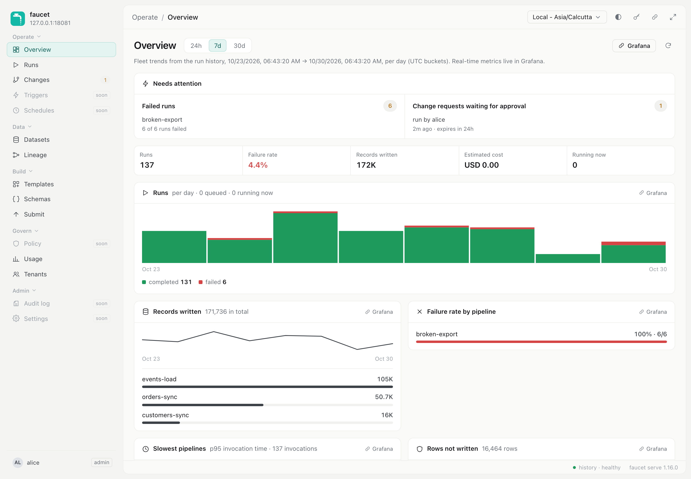
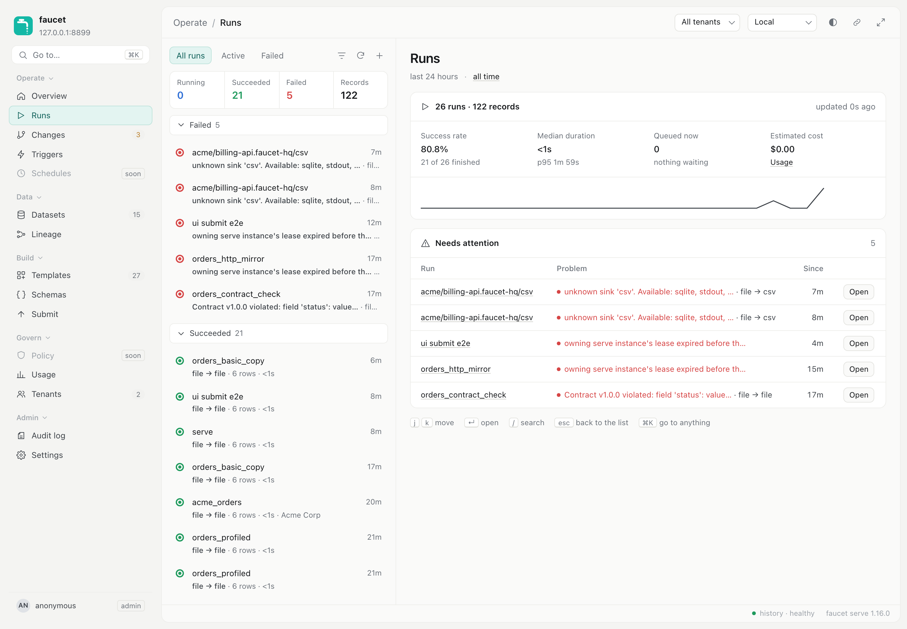
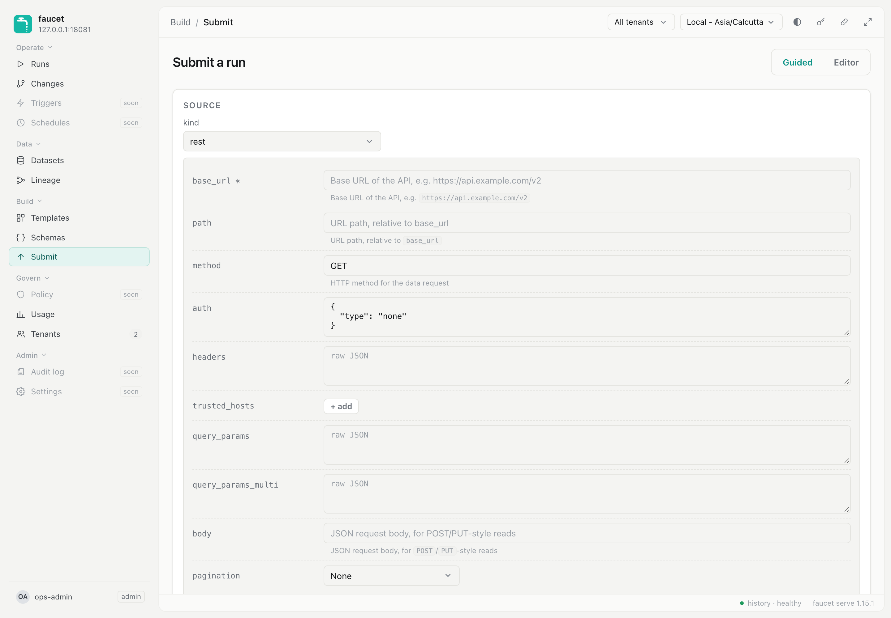
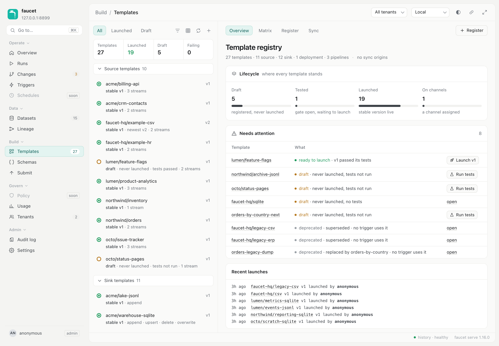
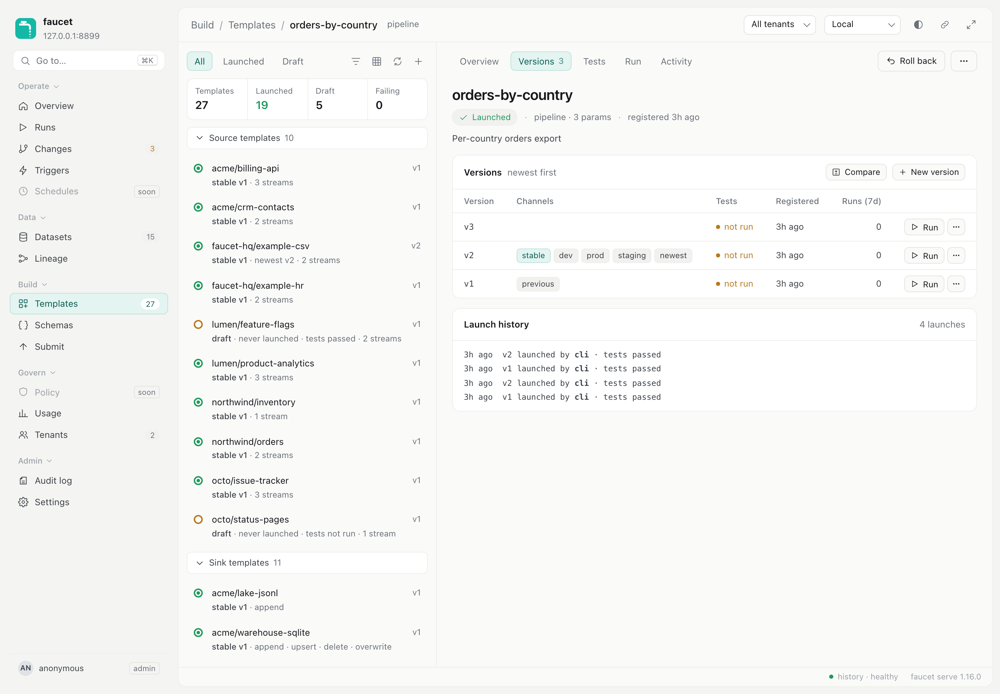
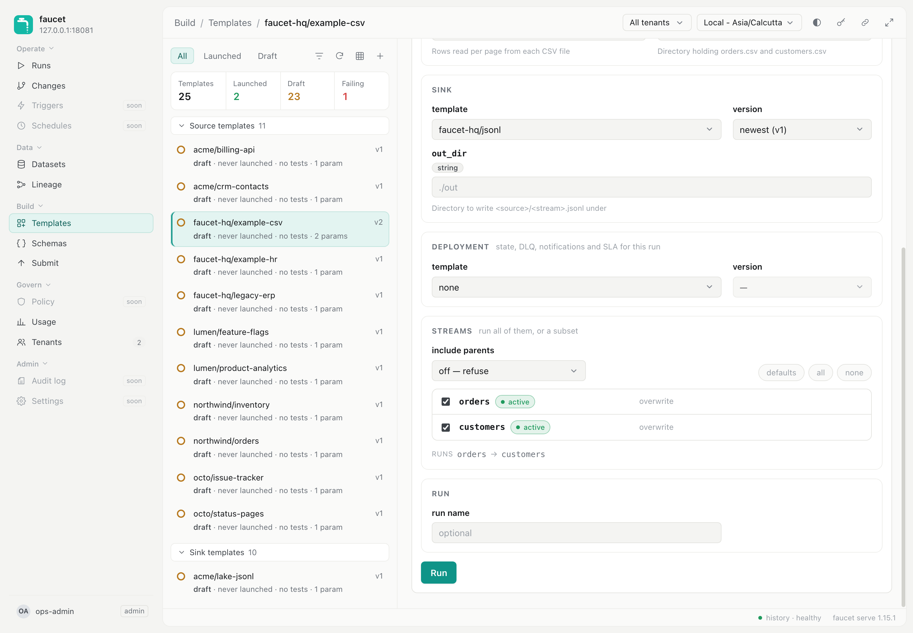
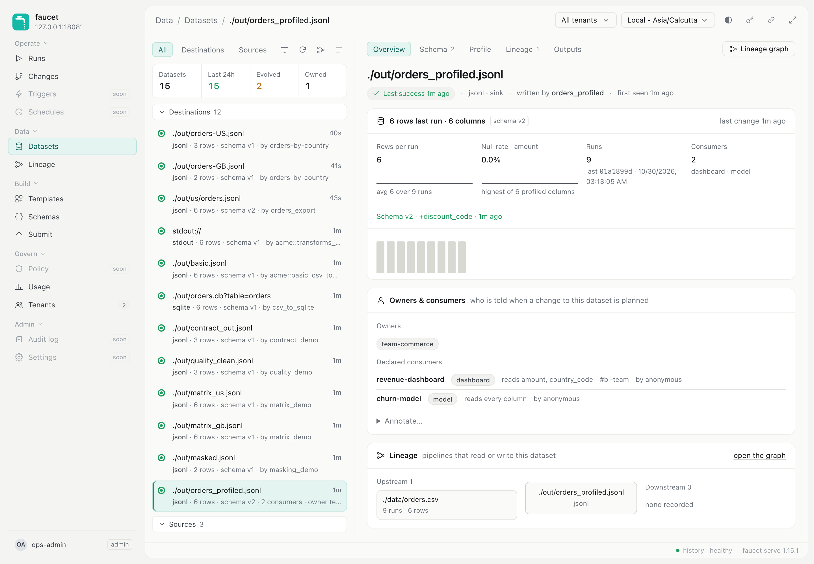
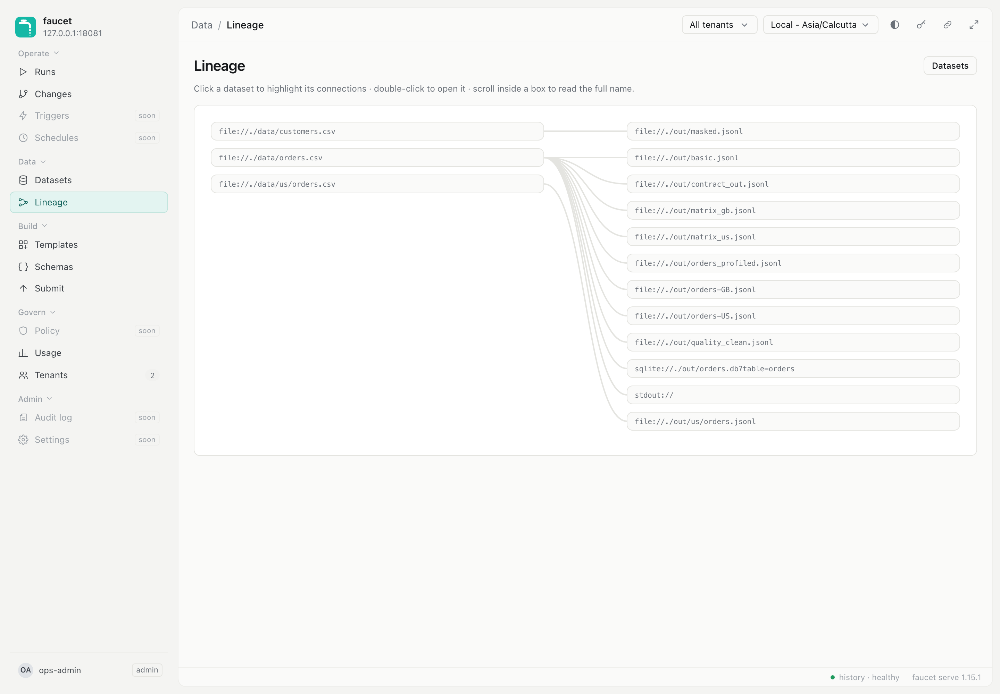
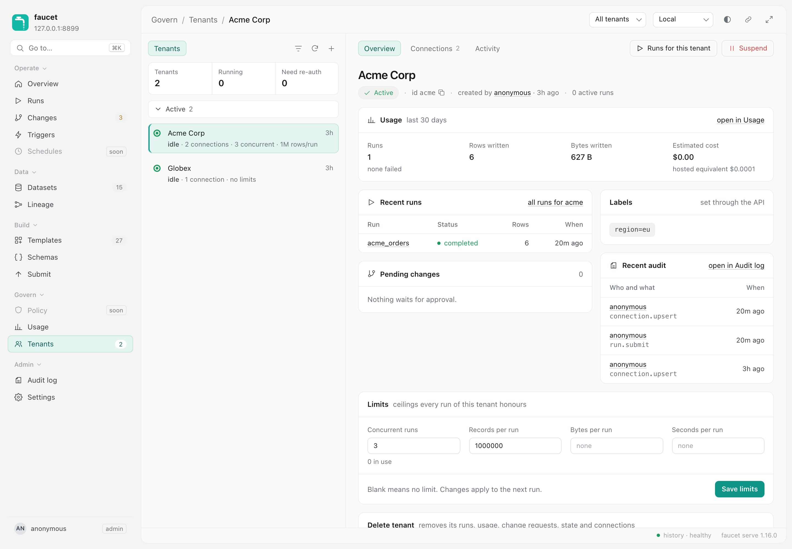

# Web console (`serve-ui`)

`faucet serve` optionally serves an embedded browser-based web console at `/`
when built with the `serve-ui` Cargo feature. The console gives you a visual
interface for the same HTTP API that `curl` or an orchestrator would use —
useful for ad-hoc runs, browsing logs, and exploring connector schemas without
leaving a browser tab.

> The console is a thin static single-page application bundled into the binary
> via `rust-embed`. There is no separate deployment and no network call during
> startup.

> **Want to see it populated in one command?** The
> [Try it locally](../getting-started/try-it-locally.md) quickstart builds the
> CLI, runs a battery of demo pipelines, and leaves this console up with Runs,
> Datasets, Lineage, and Templates already filled in — the screenshots below use
> its demo workspace.

## Enabling the feature

```bash
# Install with the embedded console (add serve-ui to your --features list)
cargo install faucet-cli --features serve-ui

# Or build locally
cargo build -p faucet-cli --features serve-ui
```

`serve-ui` implies `serve`, so you do not need to list both. The `full`
aggregate already includes `serve-ui`.

Once built, start the server normally:

```bash
FAUCET_SERVE_AUTH_TOKEN=s3cret faucet serve --listen 127.0.0.1:8080
```

Then open `http://127.0.0.1:8080/` in a browser.

## Token flow

The static shell at `/` is served **without authentication** so the browser can
load the page before it has a token. All `/v1` API calls that populate the
console's data are bearer-gated as usual.

On first load (or after a 401) the console asks for the bearer token (the same
value as `FAUCET_SERVE_AUTH_TOKEN` / `--auth-token`). The token is stored in
browser `localStorage` and sent as `Authorization: Bearer <token>` on every
subsequent `/v1` request. **Settings → Access token** (also in the ⌘K palette)
updates or clears it.

The console then asks `GET /v1/whoami` who the token belongs to, shows the
principal and role at the foot of the sidebar, and hides what that role cannot
do. A **viewer** (shown as *read-only*) sees no Submit, Run, Cancel, Delete,
Launch or Deprecate controls; an **operator** can submit and trigger runs but
not register, launch, roll back, deprecate, assign channels to, sync or delete
templates, which is **admin** work. A tenant-scoped principal sees its own
tenant only, with no Tenants, Audit log, Submit or Schemas pages. Hiding a
control is only a convenience: the server refuses the action either way, and if
a token loses a role mid-session the next refused call makes the console
re-read it and redraw.

> **Security:** the bearer token is as sensitive as the API itself — anyone who
> obtains it can submit arbitrary pipeline configs with the server's identity
> (see the [security model](./serve.md#️-security-model--read-before-exposing)).
> Serve the console only over localhost or a TLS-terminating proxy; never paste
> a production token into a browser tab on a shared machine.
>
> The shell and its assets carry a `Content-Security-Policy` that allows only
> the console's own scripts and forbids framing (`frame-ancestors 'none'`,
> `X-Frame-Options: DENY`), plus `X-Content-Type-Options: nosniff` and
> `Referrer-Policy: no-referrer`. A proxy in front must not strip them.

## Finding your way around

The sidebar groups the pages: **Operate** (Overview, Runs, Changes, Triggers,
Schedules), **Data** (Datasets, Lineage), **Build** (Templates, Schemas,
Submit), **Govern** (Policy, Usage, Tenants) and **Admin** (Audit log,
Settings). Badges count running runs, pending change requests, datasets,
templates and tenants. Schedules and Policy are marked *soon*: their pages say
what will live there and how to do it today.

- **Go to… / ⌘K** (Ctrl+K) opens a palette over pages, recent runs, datasets,
  templates, change requests, tenants and actions (submit a run, switch theme,
  copy a link).
- **Keyboard:** in any list `j` / `k` move, `Enter` opens, `Esc` goes back (or
  closes a menu), `/` focuses the search.
- **Every screen is a link.** Filters, tabs and the selected item live in the
  URL, so Back works and the link icon in the top bar copies the page you are
  looking at. Every run, dataset, template and tenant name links to its page;
  ids, URIs and configs have a copy button; relative times show the absolute
  time on hover.
- The **top bar** holds the tenant switcher (Runs, Usage and Changes follow
  it), the display time zone (every time and date input follows it), the light
  / dark switch and a button that hides the sidebar. The **status line** shows
  the run-history backend's health, cluster size and the server version.
- Below 1100px the sidebar shrinks to icons and list pages show the selected
  item in place of the list, with a back link.

## Views

### Overview

The page the console opens on (`#/overview`): what needs you, what is running
now, and how the fleet did today or this week (`?range=24h|7d`), from the
server's run history (`GET /v1/overview`), which outlives restarts and is shared
by every replica of a cluster.

- **Last 24 hours / Last 7 days:** runs, success rate, records written and the
  estimated cost, each with a trend line.
- **Needs attention:** failed runs, change requests waiting for approval,
  unhealthy triggers, templates whose newest version fails its tests and tenant
  connections that need re-authorization, each with an **Open** link.
- **Running now**, **Data freshness** (fresh, stale and schema-changed
  datasets) and the latest **Change requests**.



### Runs

Runs is a split pane: the run list on the left, the selected run on the right
(`#/runs/<id>`). The list has **All runs / Active / Failed** tabs, a stat strip
(running, succeeded, failed, records — each a filter), a filter panel (status,
name, submitter, pool, time range, labels — all in the URL), and sections for
running, queued, failed, succeeded and cancelled runs. It refreshes every few
seconds while anything is running and keeps your scroll and selection.

With nothing selected the detail pane summarizes the last 24 hours and lists
the runs that need attention.



A selected run has tabs:

- **Overview:** status, what it moved, the row accounting (accepted, coalesced,
  filtered, quarantined, dead-lettered — every row offered is accounted for),
  invocations, governance outcomes, provenance (template, pool, who submitted
  it, labels — click a label to filter runs) and the datasets it read and wrote.
  A failed run leads with its error and links to the log line and to a
  comparison with the last good run.
- **Invocations**, **Logs** (live while the run is going, with level filters),
  **Config** (the stored config, credentials masked — `GET /v1/runs/{id}/config`;
  re-run it or open it in Submit), **Dead-letter queue** (inspect, replay or
  discard, prefilled with the run's own DLQ) and **Compare** (against another
  run of the same pipeline).
- **Cancel**, **Roll back…** and **Delete** sit in the header and the **⋯**
  menu, each behind a confirmation.


### Changes

On a server started with `--require-approval`, **Changes** lists the change
requests (`#/changes/<id>`): **Needs me** and **All** tabs, a stat strip from
`GET /v1/changes/counts`, and sections for pending, executed and closed
requests. A request shows its plan (what the run, registration or launch will
do), its impact on downstream datasets, the approvals so far and its history;
**Approve** and **Reject** (with a reason) follow the server's approval policy.

### Triggers

**Triggers** lists the event triggers loaded from `--triggers`
(`GET /v1/triggers`): type, schedule or webhook methods, health, last fire and
fire / error counts. A webhook trigger shows a ready-to-paste `curl` and a
**Fire** button; a trigger in error backoff shows its last error. Without a
triggers file the page says how to add one.

### Submit

Submit builds a pipeline config and runs it, step by step: **Source**,
**Transforms**, **Sink**, **Options**, **Review**. **Guided** mode generates a
form from each connector's schema; **Editor** mode takes YAML or JSON. The live
preview on the right shows the config as it will be sent. **Validate** probes
it with the doctor, **Plan** shows what the run will do, and **Submit run**
starts it — or, when approval is required, **Request approval** creates a
change request. `#/submit?from=<run id>` starts from a past run's config;
Schemas' **Use in Submit** starts from one connector.



### Schemas

**Schemas** lists every source, sink, transform and state store compiled into
the server, with search and tabs. A connector (`#/schemas/<kind>/<name>`) shows
its fields with type, default and description — click a field for its full
description, values and constraints — an example config like `faucet init`, the
raw JSON Schema, and **Use in Submit**.

### Usage

**Usage** groups the recorded usage (`GET /v1/usage`) by pipeline, row,
dataset, sink, day or tenant over a date range, with sortable columns, a daily
chart and a CSV download; click a row to drill into it.

### Templates

**Templates** is a split pane over the [template registry](./templates.md):
sections for source templates, sink templates, pipelines and deployments, each
row with its stable version and status. With nothing selected the detail pane
holds the registry views: the **Matrix** of source × sink pairings, **Register**
(paste a document; the server tests it if it has a `tests:` block) and **Sync**
from configured origins.



A template (`#/templates/<id>`) has tabs:

- **Overview:** its lifecycle (registered → tested → launched), params, streams
  and who uses it.
- **Versions:** every version with its channels, test status and runs in the
  last 7 days, **Run** and a **⋯** menu (assign a channel, run tests, show
  config, deprecate, delete); **Compare** diffs two versions; **Launch**,
  **Roll back** and **New version** sit in the header; the launch history below.
- **Tests:** the test bundle and its results per version.
- **Run:** a form generated from the template's `params:`, the sink template
  and overlay to pair a source template with, and the streams to run with the
  resolved run set.
- **Pairings** (source templates) and **Activity** (its runs and registrations).





### Datasets & Lineage (Data Movement Catalog)

On a server built with the `catalog` feature, **Datasets** lists every dataset
a pipeline has read or written (`#/catalog/<id>`): **All / Destinations /
Sources** tabs, filters, and freshness at a glance. A dataset has tabs:

- **Overview:** rows, columns, rows per run, null rates, usual cadence,
  consumers, a small lineage graph, owners and consumers, and the runs that
  wrote it.
- **Schema:** the schema timeline; compare any two versions.
- **Profile:** column profiles and drift findings.
- **Lineage**, **Activity** (runs that read or wrote it,
  `GET /v1/runs?dataset_id=`) and **Outputs** (local files, below).
- **Annotate** records owners and consumers (`catalog_annotate`).



**Lineage** draws every dataset and the pipelines between them: drag to pan,
scroll to zoom, fit and a minimap; pick a dataset to focus on it with a number
of hops up and down, see it in the side panel, and trace one column through
the graph.



### Cleaning up local outputs

The Datasets page is also where the **local files** the server's sinks wrote
(jsonl / csv / parquet) are listed and reclaimed — cleanup of *data artifacts*
belongs next to the data artifacts, not on the Runs tab, which is about execution
history. A **Local outputs** panel fills the Datasets detail pane while no dataset
is selected (the list's outputs button opens it), and each dataset's **Outputs**
tab holds the same panel scoped to that dataset. Each tracked file shows its age
and state:

| State | Meaning |
|---|---|
| `present` | on disk |
| `expired` | already cleaned — the file is gone, the record is kept |
| `external` | faucet wrote this file but did not create it (appended to it), so it is never cleaned and never previewed |
| `replaced` | the file already existed, but faucet truncated it, so it holds only faucet's output — previewable, still never cleaned |

Controls, when your role holds `LocalOutputManage` (`operator` and up — a
`viewer` sees the list and no buttons):

- **Delete now** on any `present` output.
- **Purge older than N days**, prefilled with the server's configured window.
  On a dataset's detail page it purges only that dataset's outputs.
- **Clean all local outputs** — behind a confirm, because it also removes files
  still inside their retention window. On a dataset's detail page the same button
  is scoped to that dataset.

The model to keep in mind: **data artifacts are disposable; run history is
durable.** Cleaning an output removes the *file* — the run record is untouched,
so the Runs tab still shows what ran, and the output re-renders as `expired`
rather than as a broken row. Only files faucet created are ever deleted (never a
glob, never a directory); a skipped file always comes with the reason, so a "0
files" result never looks like a broken button. The same operations run
automatically on a timer — see
[Local output retention](../reference/cli.md#local-output-retention).

### Previewing what a run actually wrote

"12 records written" tells you the run finished. It does not tell you whether the
transform did what you meant. On a server started with
`--preview-local-outputs`, each tracked jsonl / csv / parquet output in the
**Local outputs** panel grows a **Preview** button: it expands inline and renders
the file's first rows as a table, with a row-count input bounded by the server's
own cap.

500 rows load by default; the row box takes any number up to the server's
ceiling, and **All rows** asks for the whole dataset:

```bash
# Local iteration loop: previews on, 500 rows by default, ceiling at 5000.
FAUCET_SERVE_AUTH_TOKEN=s3cret faucet serve --preview-local-outputs

# …and with no ceiling, so "All rows" really loads the whole file.
FAUCET_SERVE_AUTH_TOKEN=s3cret faucet serve \
  --preview-local-outputs --preview-max-rows 0
```

What the table shows:

- **Columns** are the union of the records' fields, so a field only some records
  carry still gets a column — a preview never hides something that was written.
- A **missing** field renders `—` and a `null` one renders `null`; they are
  different facts about the record.
- The status line always says which it is: "*whole dataset*", or "*stopped at the
  row limit — the dataset has more*". 500 rows of a million-row file can never be
  mistaken for the file, and a complete read says so rather than leaving you to
  infer it from the absence of a warning.
- A record that is not a JSON object (a bare scalar or array per line — legal
  NDJSON) is rendered across the row rather than as a line of blanks.

Under the hood it is a **source-backed capped read**: the server reads the output
back through the matching *source* connector and stops once it has enough rows,
so previewing a huge file touches only its first pages. There is no paging —
these files are sequential streams with no row index, so "show me more" is just a
larger limit, which is why the panel has a row box and an **All rows** button
instead of *Next page*.

**On a server with a ceiling, "All rows" gives you the ceiling** (the status line
says it stopped at the row limit). An uncapped server gives you everything — and
still stops at a 64 MiB response budget or a 30-second deadline if the dataset is
larger than that, saying which. A partial answer always names the bound that
produced it.

A `present` or `replaced` output gets a Preview button. An `expired` one has no
file left, and an **`external`** one — a file faucet appended to but did not
create — is never previewed: the part that predates faucet is not faucet's to
serve, which is the read-side twin of the retention GC's refusal to delete it. A
**`replaced`** file also already existed, but faucet truncated it, so every byte
in it is faucet's output; it is previewed, and still never cleaned. Each served preview is recorded in the
audit log as `local_output.preview`.

**It is off by default and intended for local testing** — it returns file
*contents* over HTTP, and reading needs only `LocalOutputRead` (`viewer` and up),
so enabling it lets every viewer see the data those pipelines wrote. Without the
flag no Preview button is rendered at all (the list response says the capability
is off), and a direct API call is refused with a `403` naming the flag. A preview
of an output that retention already cleaned shows the "cleaned up — the run
record is kept" message in place of the table, never an error toast. Full detail:
[Dataset preview](../reference/cli.md#dataset-preview-of-local-outputs).

### Tenants

On a server built with the `tenants` feature, **Tenants** is a split pane over
the [tenants](./embedded-integrations.md) (`#/tenants/<id>`), with active and
suspended sections and **+** to create one. A tenant has **Overview** (limits,
labels, recent runs), **Connections** (names, types and status — never
credentials — with a **Connect** flow per `--connect-providers` provider, stored
credentials, **Reconnect** and **Delete**) and **Activity**. **Suspend** /
**Resume** and **Delete** (type the id to confirm) sit in the header. Creating,
suspending and deleting tenants needs `tenant_admin`; connections need
`connection_manage`.



### Audit log and Settings

**Audit log** (admins) lists every recorded action and denial (`GET /v1/audit`):
filters by principal, action, result and time, a **Denials** tab, and the
entry's detail with the run it started (`#/audit/<id>`). **Settings** shows who
you are and what you may do, the access token, theme and time zone, the
keyboard shortcuts, the server (version, history backend, cluster replicas) and
the default config with **Reload**.

## Disabling the console at runtime

If you built with `serve-ui` but want to serve only the API (no static assets),
pass `--no-ui`:

```bash
FAUCET_SERVE_AUTH_TOKEN=s3cret faucet serve --no-ui
```

`/` and `/assets/*` return 404; the `/v1` API and the unauthenticated probes
(`/healthz`, `/readyz`, `/metrics`) are unaffected.

## New API endpoints

The console calls these bearer-gated endpoints (any other client can too):

| Method | Path | Description |
|--------|------|-------------|
| `GET` | `/v1/schemas` | Catalog of all compiled sources, sinks, transforms, and state-store kinds. |
| `GET` | `/v1/schemas/{kind}/{name}` | JSON Schema for one connector, transform, or pipeline block (`kind` ∈ `source`/`sink`/`transform`/`block`). Returns 404 for unknown kind or name. |
| `GET` | `/v1/whoami` | The caller's principal, role and permissions; the console uses it to hide controls the role cannot use. |
| `GET` | `/v1/overview` | Fleet trends over the run history, behind the Overview page. |
| `GET` | `/v1/runs/{id}/config` | A run's stored config, credentials masked, behind the run's Config tab. |
| `GET` | `/v1/triggers` | The loaded triggers with health and fire counts, behind the Triggers page. |
| `GET` | `/v1/audit/{id}` | One audit entry, behind the Audit log's entry links. |
| `POST` | `/v1/doctor` | Validate and probe a submitted config without running it. Returns 200 (all probes pass) or 422 (any probe fails) with a probe report. Request body: `{ "config": "<yaml-or-json>", "config_format": "yaml" }`. |

With the `catalog` feature the console also drives the local-output endpoints —
`GET /v1/local-outputs`, `DELETE /v1/local-outputs/{id}`,
`POST /v1/local-outputs/cleanup`, and (with `--preview-local-outputs`)
`GET /v1/local-outputs/{id}/preview` — documented in the
[HTTP API reference](../reference/http-api.md#local-sink-outputs).

These endpoints require the `serve` feature and are available at runtime
regardless of whether `--no-ui` was passed.

## Related pages

- [Running faucet as a service](./serve.md) — the full `faucet serve` guide.
- [HTTP API reference](../reference/http-api.md) — complete endpoint/schema reference.
- [`faucet serve` CLI flags](../reference/cli.md#serve) — all `faucet serve` flags.
